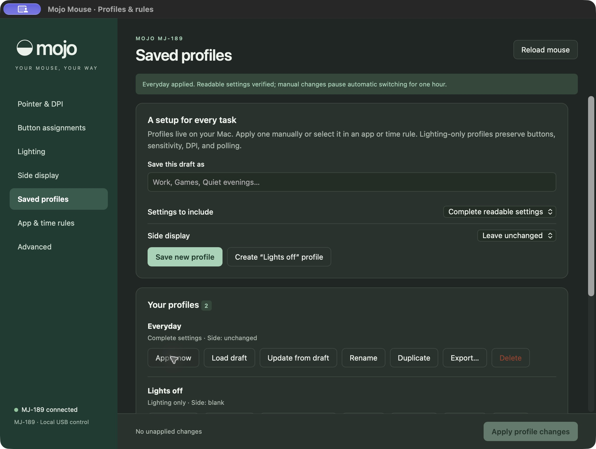
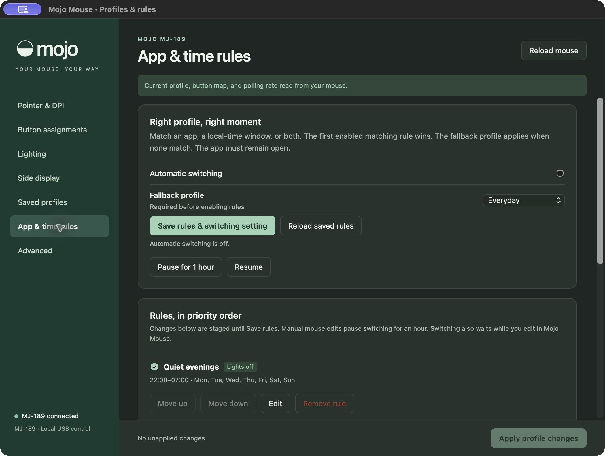

# Mojo Mouse for macOS

**Control your MOJO MJ-189 mouse from a Mac:** turn off RGB lights, write custom side-display text, adjust DPI and buttons, and switch profiles by app or time of day.

[](https://github.com/mkerkstra/mojo-mouse-macos/releases/latest/download/Mojo-Mouse-macOS-universal.dmg)
[](https://github.com/mkerkstra/mojo-mouse-macos/actions/workflows/ci.yml)
[](#compatibility)
[](#download-and-install)
[](LICENSE)

Independent, open-source software. No Windows VM, account, cloud service, or telemetry. **Currently supports only the wired MOJO MJ-189 with USB ID `260d:1027`.** Support for other MOJO models is not implied.



## Download and install

1. Download **[Mojo-Mouse-macOS-universal.dmg](https://github.com/mkerkstra/mojo-mouse-macos/releases/latest/download/Mojo-Mouse-macOS-universal.dmg)** from [Releases](https://github.com/mkerkstra/mojo-mouse-macos/releases/latest). A [ZIP](https://github.com/mkerkstra/mojo-mouse-macos/releases/latest/download/Mojo-Mouse-macOS-universal.zip) is also available. One app supports Intel and Apple Silicon Macs.
2. Open the disk image and drag **Mojo Mouse** into **Applications**.
3. Connect one supported mouse over USB and open the app.

**First launch:** this initial release is ad-hoc signed, **not Developer ID signed or Apple notarized**. macOS may block it. If you trust the source and release checksum, try opening it, then use **System Settings → Privacy & Security → Open Anyway**. See [Apple’s instructions](https://support.apple.com/en-us/102445). Do not disable Gatekeeper system-wide. Building from source is another option.

Release assets include `SHA256SUMS.txt`. The automatically generated GitHub “Source code” downloads contain source, **not the executable app**.

## What you can do

- **Lights:** turn off body and wheel RGB, blank the side display, restore the initial lighting, and set wheel colors for each DPI stage.
- **Side display:** send short custom text with a 96 × 39 pixel preview, show the MOJO logo or built-in information, or blank the display. Text wraps and shrinks to fit; marquee is not provided.
- **Pointer and buttons:** edit eight DPI stages, X/Y scaling, polling rate, button assignments, media actions, and single-modifier shortcuts.
- **Named profiles:** save, rename, duplicate, update, import, export, and apply setups. A lighting-only profile leaves pointer settings, buttons, and polling unchanged.
- **App & time rules:** switch profiles for a foreground app, a weekday/time window, or both. Choose a fallback and reorder rules by priority.
- **Menu bar:** apply saved profiles, pause switching for an hour, resume it, or reopen the app.
- **Backups:** preserve original readable settings and back up before changing them. Imports do not change hardware until applied.

### A useful starting setup

Save your current draft as **Everyday**, then click **Create “Lights off” profile**. In **App & time rules**, choose Everyday as the fallback and add a Lights off rule from 22:00 to 07:00. Enable switching and save the rules. You can also add an app-only rule for your editor or game and move it above the time rule.

Automatic switching is **off on a fresh install**. It requires a fallback and at least one enabled rule. Keep the app open; with rules enabled, closing its windows leaves the menu-bar app running. Quit stops switching. No login item is installed.

## Predictable switching

- The **first enabled matching rule** wins. An app and a schedule in the same rule must **both** match.
- When no rule matches, the fallback profile applies. Display settings marked **Leave unchanged** intentionally preserve whatever is displayed.
- Times use the Mac’s current time zone. End times are exclusive. An overnight window belongs to its starting day: Monday 22:00–07:00 includes Tuesday morning.
- Foreground-app changes are debounced; schedules are checked every 15 seconds. The same selection is not repeatedly written. Reconnecting the mouse reapplies the selected setup.
- Manual edits and profile applications pause switching for one hour. Resume from the menu bar or rules page. Switching waits while you edit in Mojo Mouse.
- Automatic rules upload readable profile settings and optional static display text. They **never upload macro or rapid-fire recipes**.



See [profiles and rules](docs/profiles-and-rules.md) for examples and recovery behavior.

## Compatibility

| Item                                | Current status                                                            |
| ----------------------------------- | ------------------------------------------------------------------------- |
| MOJO MJ-189, USB `260d:1027`        | One physical device tested; reported HID version `0x0316`                 |
| Other MOJO models / other USB IDs   | Unsupported; no writes are attempted to other IDs                         |
| macOS                               | Built for macOS 13 or later                                               |
| Apple Silicon                       | Native build; physical USB checks performed on Apple Silicon              |
| Intel                               | Native universal-binary slice; CI exercises the executable on Intel       |
| Profile, button-map, polling writes | Read back and verified after changes                                      |
| Side text and blank display         | Visually confirmed on the test mouse; display content cannot be read back |
| Other firmware revisions            | Not physically tested; matching IDs alone do not prove compatibility      |

This is an early release, not a claim of exhaustive hardware coverage. Please submit a [compatibility report](https://github.com/mkerkstra/mojo-mouse-macos/issues/new?template=compatibility.yml) if you test another revision. Read [hardware support and validation](docs/hardware-support.md) before relying on untested behavior.

### Experimental controls

Macros, rapid fire, lift-off height, and raw profile-byte editing require **Advanced → Show unverified features**. These commands are based on the vendor protocol; their physical behavior has not been fully acceptance-tested. Some cannot be read back at all. Enabling the controls is not proof of support. Existing macro memory cannot be imported from the mouse, and sending a macro replaces that slot.

Windows cursor speed, double-click speed, acceleration, and scroll speed are host preferences, not portable mouse profile settings. Use macOS Mouse settings for their Mac equivalents.

The separately branded **Pointer Profiles** Mac App Store target is being prepared under the same open-source project. See [store distribution](docs/app-store.md). An available Xcode target does not imply Apple approval or public store availability.

## Privacy and recovery

Read the [privacy policy](PRIVACY.md).

In the direct-download edition, profiles, rules, recipes, backups, and the last 100 status events stay under:

```text
~/Library/Application Support/Mojo Mouse/
```

No network access is used by the app. App rules use application identifiers from `NSWorkspace`; they do not read keystrokes or window contents and do not need Accessibility or Input Monitoring permission.

Before readable settings change, the app saves a backup. It keeps the newest 50 generated snapshots plus the immutable original backup. If applying a profile fails, it attempts to restore and verify previous readable settings. A disconnect can prevent rollback, in which case the app reports that settings may have changed. Reload after reconnecting and import a backup if needed. Display contents cannot be backed up from hardware.

A corrupt library is reported without silently overwriting it. See [troubleshooting](docs/troubleshooting.md).

## Build and test

Requires Xcode Command Line Tools to build. Contribution checks use Xcode 16 or newer, Node.js 24, npm 11, and ShellCheck. No third-party runtime packages are needed by the app.

```bash
xcode-select --install
./scripts/build.sh
open "build/Mojo Mouse.app"
```

The build cross-compiles for `arm64` and `x86_64`, combines both slices, and ad-hoc signs the app. It does not contact Apple or notarize the result. A Developer ID identity can be provided using `CODE_SIGN_IDENTITY`; signing alone is not notarization.

```bash
./scripts/test.sh
"build/Mojo Mouse.app/Contents/MacOS/MojoMouse" --version
"build/Mojo Mouse.app/Contents/MacOS/MojoMouse" --diagnose
```

`--diagnose` is read-only and omits serial numbers, app lists, usernames, profile contents, and local file paths. Tests use simulated hardware for rule decisions, persistence, scope boundaries, validation, rollback, and disconnect handling. They do not flash or configure a connected mouse.

The shared CI/release checks enforce style, syntax, ShellCheck, warning-free builds, tests, and npm vulnerability auditing. Dependabot maintains the exact development-tool and GitHub Action pins. See [dependency hygiene](CONTRIBUTING.md#code-and-dependency-hygiene).

Read [CONTRIBUTING.md](CONTRIBUTING.md), the [protocol notes](docs/protocol.md), and the [release process](docs/releasing.md) before extending device support.

## License and attribution

[MIT](LICENSE). This repository contains independently written code and an original icon. It does not redistribute MOJO’s Windows installer, binaries, fonts, or artwork. MOJO names and trademarks belong to their respective owners. This project is not affiliated with or endorsed by MOJO.
